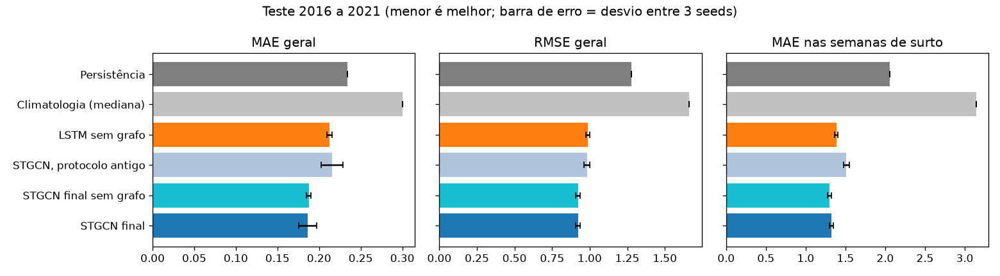
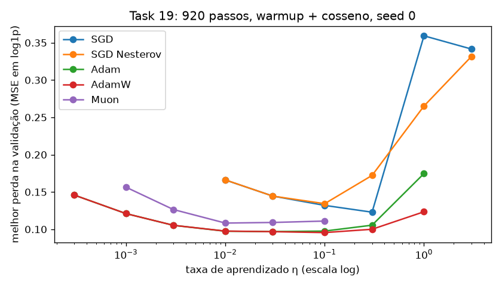
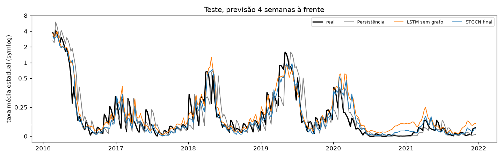

# STGNN-Dengue

Previsão semanal da taxa de internações por dengue nos 79 municípios do estado do Rio de Janeiro (1999 a 2021) com uma rede neural espaço-temporal em grafo (STGCN). O STGCN é comparado a baselines honestos, e o projeto inclui um estudo de otimizadores, agendas de taxa de aprendizado e funções de perda.

Projeto final da disciplina GBC073 (UFU).

## Resultado em uma frase

No teste (2016 a 2021, usado **uma única vez**), o STGCN final erra **20% menos que a persistência** e **12% menos que um LSTM sem grafo** (MAE). Quase todo o ganho vem da arquitetura convolucional no tempo e do protocolo de treino. **O grafo geográfico não fez diferença mensurável.**



| Modelo (teste 2016–2021, 3 seeds) | MAE | RMSE | MAE em surto | MAE em calmaria |
| --- | --- | --- | --- | --- |
| Persistência (repete a última semana) | 0,234 | 1,276 | 2,057 | 0,163 |
| Climatologia (mediana da semana do ano) | 0,300 | 1,662 | 3,141 | 0,189 |
| LSTM sem grafo | 0,213 ± 0,003 | 0,988 ± 0,012 | 1,387 ± 0,021 | 0,167 ± 0,003 |
| STGCN, protocolo antigo (Adam 1e-3, MSE) | 0,216 ± 0,013 | 0,982 ± 0,018 | 1,512 ± 0,033 | 0,165 ± 0,014 |
| STGCN final sem grafo (A = I) | 0,188 ± 0,003 | 0,922 ± 0,013 | 1,300 ± 0,023 | 0,144 ± 0,004 |
| **STGCN final** | **0,187 ± 0,011** | **0,923 ± 0,015** | **1,326 ± 0,025** | **0,142 ± 0,011** |

A tabela está em `results/teste_final_tabela.csv`, e a análise completa está em `notebooks/05_resultado_final.ipynb`.

## O problema

- **Entrada:** as últimas W = 4 semanas de cada município, com 4 variáveis: taxa de internações, temperatura máxima, precipitação e umidade mínima.
- **Saída:** a taxa de internações das H = 4 semanas seguintes, para os 79 municípios de uma vez.
- **Métricas:** MAE e RMSE na escala original da taxa, por horizonte e no geral. Também medimos o MAE nas **semanas de surto**, que são as semanas em que a média estadual passa do quantil de 90% do treino.

## Dados

Usamos o dataset *Brazil-Dengue-Arboviral-Diseases* (Zenodo), recortado para o RJ: 79 municípios × 1.199 semanas, sem dados faltando. A fonte, o arquivo esperado e as colunas estão descritos em [`data/README.md`](data/README.md). Os dados não estão no git.

| Partição | Período | Uso |
| --- | --- | --- |
| Treino | 1999 a 2012 | ajustar os pesos e a normalização |
| Validação | 2013 a 2015 | **todas** as escolhas: modelo, η, agenda, perda e época |
| Teste | 2016 a 2021 | aberto uma única vez, no fim (task 21) |

A normalização é ajustada só no treino, e o alvo é treinado em `log1p`. Há testes automáticos contra vazamento: `tests/test_split.py`, `tests/test_normalizacao.py` e `tests/test_avaliacao_final.py`. No último, multiplicar a taxa do teste por 1000 não muda nenhuma métrica da validação.

## Método

1. **Baselines sem treino:** persistência e climatologia. Todo modelo treinado precisa superá-los.
2. **LSTM sem grafo:** os mesmos pesos para todos os municípios. Cada município só vê o próprio passado.
3. **Grafo geográfico:** cada município se liga aos 5 vizinhos mais próximos (distância haversine), com peso gaussiano. Um teste de permutação confirma que municípios vizinhos são mais correlacionados que pares sorteados (0,327 contra 0,282, p < 0,001), mas a diferença é pequena.
4. **STGCN:** um bloco formado por convolução temporal causal com GLU, convolução de Chebyshev no grafo (K = 3, 32 canais) e outra convolução temporal. O bloco tem conexão residual e LayerNorm.
5. **Ablação:** o mesmo STGCN com a Laplaciana trocada pela identidade, ou seja, sem nenhuma troca de informação entre municípios.
6. **Protocolo de treino:** orçamento fixo de 920 passos com lote 32 e clip 5. Valem os pesos da melhor época na validação. Com o orçamento igual para todos, a comparação entre otimizadores é justa.
7. **Otimizadores e agendas** (task 19): SGD, SGD Nesterov, Adam, AdamW e Muon, cada um numa grade de η. Depois, as agendas constante, cosseno, warmup + cosseno e multistep. Os finalistas foram confirmados com 3 seeds.
8. **Perdas** (task 20): MSE em `log1p`, Huber em `log1p` e Tweedie.



O **η importa mais que o otimizador**. Adam e AdamW têm um vale largo e plano entre η = 0,01 e 0,1. O SGD precisa de um η bem mais ajustado e fica atrás mesmo no melhor ponto. A configuração final usa **AdamW com η = 0,01, warmup + cosseno e perda Huber**. O η = 0,01 está dentro do vale plano da comparação de perdas (task 20). O melhor ponto da grade com uma seed foi η = 0,1, com uma diferença de perda de 0,002. Essa configuração ficou congelada em `configs/final.yaml` **antes** de abrir o teste.

## Como a previsão se comporta



- **Calmaria** (96% das semanas do teste): o STGCN final tem o menor erro, com viés praticamente zero.
- **Surto:** o MAE do STGCN é o menor dos modelos, mas ele **subestima os picos** (viés de −0,45). Isso é efeito de treinar em `log1p`. Em h = 4, a persistência fica atrasada: o pico dela aparece semanas depois do real.

## Limitações

- **O grafo não ajudou.** O STGCN sem grafo empata no teste e foi um pouco melhor na validação. Mantivemos o grafo geo porque essa decisão foi tomada antes do teste, e trocar depois de ver o teste seria escolher pelo teste. A dependência espacial no RJ, medida na semana, é fraca.
- **Poucos surtos no teste:** só 13 semanas passam do limiar, todas no início de 2016. A análise de surto deve ser lida como indicativa.
- **O erro se concentra** nos municípios com taxa alta (correlação de 0,96 entre o MAE e a taxa média). Nos municípios com taxa quase sempre zero, a persistência é praticamente imbatível.

## Como reproduzir

Requer Python 3.11 ou mais novo. Tudo roda em CPU. Os tempos abaixo são de um notebook comum.

### 1. Ambiente

```bash
git clone https://github.com/pupa-tech/STGNN-Dengue.git
cd STGNN-Dengue
python -m venv .venv
source .venv/bin/activate        # Windows: .venv\Scripts\activate
pip install -e ".[dev]"
pytest                           # pouco mais de 100 testes, sem precisar dos dados
ruff check .
```

### 2. Dados

Baixe o dataset do Zenodo e copie o arquivo `dengue_33_rio_de_janeiro.csv` para `data/`, como explicado em [`data/README.md`](data/README.md). Na primeira execução, o código gera a tabela limpa `data/tabela_rj.csv` sozinho.

### 3. Resultados na validação

Cada comando grava um CSV em `results/`. Os CSV já versionados são sobrescritos com os mesmos números, porque as seeds são fixas.

```bash
python -m dengue.baselines           # persistência e climatologia   -> results/baselines_validacao.csv
python -m dengue.lstm_validacao      # LSTM, 3 seeds                 -> results/lstm_validacao.csv
python -m dengue.stgcn_validacao     # STGCN geo e sem grafo, 3 seeds -> results/stgcn_validacao.csv
```

### 4. Otimizadores, agendas e perdas

Os experimentos usam o executor por YAML. Se o log de um par (experimento, seed) já existe, ele é pulado. Por isso, para refazer tudo do zero, use uma pasta nova em `--resultados`.

```bash
python -m dengue.experimento configs/base.yaml --resultados novo/        # STGCN com Adam 1e-3 (cerca de 1 min por seed)
python -m dengue.varredura configs/otimizacao/etapa2.yaml --resultados novo/  # η × otimizador
python -m dengue.varredura configs/otimizacao/etapa3.yaml --resultados novo/  # agendas
python -m dengue.varredura configs/otimizacao/etapa4.yaml --resultados novo/  # 3 seeds nas finalistas
python -m dengue.experimento configs/perdas/mse.yaml --resultados novo/perdas
python -m dengue.experimento configs/perdas/huber.yaml --resultados novo/perdas
python -m dengue.experimento configs/perdas/tweedie.yaml --resultados novo/perdas
```

### 5. Avaliação final no teste

```bash
python -m dengue.avaliacao_final --resultados novo/   # cerca de 15 min
```

O script se recusa a rodar se já houver `teste_final*.csv` na pasta de saída. No projeto, ele rodou uma única vez.

### 6. Figuras e notebooks

```bash
python -m dengue.figuras    # as 3 figuras deste README, a partir dos CSV -> results/figuras/
```

Os notebooks só leem os CSV de `results/` (o `02_grafo` também lê os dados) e contam a história na ordem:

| Notebook | Pergunta |
| --- | --- |
| `01_dados.ipynb` | Como são os dados? Há sazonalidade, defasagem com o clima, dependência entre municípios? |
| `02_grafo.ipynb` | Vizinhos geográficos são mais parecidos que pares sorteados? |
| `03_modelos.ipynb` | O STGCN supera os baselines e o LSTM? O grafo ajuda? |
| `04_otimizacao.ipynb` | Qual otimizador, η e agenda treinam melhor o STGCN, e por quê? |
| `04b_perdas.ipynb` | MSE, Huber ou Tweedie? |
| `05_resultado_final.ipynb` | Como fica tudo no teste, em surto e em calmaria? |

## Estrutura

```
src/dengue/
  dados.py            carga, limpeza, split temporal, janelas e normalização
  metricas.py         MAE, RMSE por horizonte, limiar e MAE de surto
  grafo.py            k-NN geográfico, Laplacianas e teste vizinhos × aleatórios
  modelos.py          LSTM e STGCN
  treino.py           treino com early stopping (validações das tasks 14 a 17)
  perdas.py           MSE, Huber e Tweedie
  experimento.py      executor por YAML com orçamento fixo e logs por camada
  varredura.py        grade de experimentos a partir de um YAML
  baselines.py, lstm_validacao.py, stgcn_validacao.py   resultados na validação
  avaliacao_final.py  avaliação única no teste
  figuras.py          figuras do README
configs/              YAML dos experimentos (base, otimizacao/, perdas/, final.yaml)
notebooks/            a narrativa do estudo; só importam de src/
results/              tabelas, logs e figuras
tests/                testes automáticos, principalmente contra vazamento
data/                 dados brutos (fora do git)
```

## Contribuições

O trabalho foi dividido em tasks. Cada task tinha um dono, era feita numa branch própria e entrava por PR revisado pela outra pessoa.

| Quem | O que fez |
| --- | --- |
| **Gabriel Amorim** ([gabrielhca](https://github.com/gabrielhca)) | Infraestrutura: estrutura do pacote, CI com ruff e pytest, proteção do `main`, templates e board. Métricas comuns e definição de surto. Grafo k-NN geográfico e o notebook `02_grafo`. STGCN e ablação do grafo (`03_modelos`). Executor de experimentos com orçamento fixo, logs por camada e Muon. README e figuras finais. |
| **Gabriel Moutinho** ([IMoutinho](https://github.com/IMoutinho)) | Carga e limpeza dos dados e a EDA (`01_dados`). Split temporal, janelas e normalização, com os testes contra vazamento. Baselines de persistência e climatologia. LSTM sem grafo. Varredura de otimizadores e agendas (`04_otimizacao`). Comparação de perdas (`04b_perdas`). Avaliação final no teste (`05_resultado_final`). |
